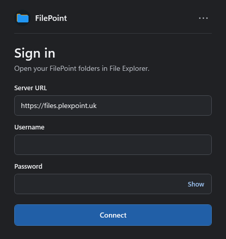
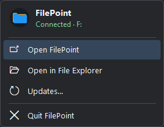

<p align="center">
  
</p>

<h1 align="center">FilePoint for Windows</h1>

<p align="center">
  Open your FilePoint folders and custom icons directly in Windows File Explorer.
</p>

<p align="center">
  <a href="https://github.com/JNathan34/FilePoint-Windows-Downloads/releases/latest"></a>
</p>

## Install FilePoint

| Your PC | Download |
| --- | --- |
| **Snapdragon X Elite** or another Windows 11 ARM64 PC | [**Download ARM64 Setup**](https://github.com/JNathan34/FilePoint-Windows-Downloads/releases/latest/download/FilePoint-Setup-arm64.exe) |
| **Intel or AMD** PC running Windows 10 or 11 | [**Download x64 Setup**](https://github.com/JNathan34/FilePoint-Windows-Downloads/releases/latest/download/FilePoint-Setup-x64.exe) |

1. Run Setup and select **Install**. Setup downloads the matching signed Dokan driver if Windows needs it.
2. Open FilePoint and enter your server URL, username, and password. FilePoint prompts for a verification code if your account requires one.
3. Select **Connect** to open your FilePoint drive in Explorer.

## A closer look

<table>
  <tr>
    <td width="58%" valign="top">
      <strong>Sign in to your server</strong><br>
      Your URL, username, and password are all you need to get started.<br><br>
      
    </td>
    <td width="42%" valign="top">
      <strong>Manage FilePoint from the tray</strong><br>
      See your connection and drive letter, open Explorer, or check for updates.<br><br>
      
    </td>
  </tr>
</table>

## In File Explorer

- FilePoint appears in the Explorer sidebar and under **This PC**. It prefers **F:** and uses another available letter if Windows has already assigned it.
- Custom folder icons appear inside the drive. When the server provides capacity statistics, Explorer shows the total and free space for the drives your account can access.
- The **Connected devices** folder shows USB drives and phones that the FilePoint server has mounted and your account can access. Refresh the folder after connecting or disconnecting a device.
- Files open on demand while you’re connected. The Explorer mount is read-only.
- Minimize FilePoint to keep it in the notification area. Double-click the tray icon to reopen it, or select **Quit FilePoint** to unmount the drive.

## Updates

FilePoint checks GitHub automatically. You can also select **Updates** in the tray menu or in the app’s **⋯** menu. It downloads the installer for your PC and verifies its SHA-256 digest before opening Setup. GitHub downloads and updates work without an account or token.

If you’re on version **1.3.0 or earlier**, quit FilePoint from the notification area and run the latest Setup once to switch to the public update feed.

[Release notes, checksums, and standalone MSIs](https://github.com/JNathan34/FilePoint-Windows-Downloads/releases/latest)

<details>
<summary>Advanced sign-in and installation</summary>

Accounts using SSO or passkeys can select **Sign in with an API token** in FilePoint’s **⋯** menu. Create the token in your FilePoint web app with access to the required storage sources and permission to download files.

The desktop runtime is bundled. Standalone MSIs are available for managed installation when Dokan is already installed. FilePoint Setup is unsigned, and each release includes SHA-256 checksums.

</details>

## Build and release

On Windows with PowerShell 7 and the .NET 10 SDK:

```powershell
dotnet run --project tests -c Release
./installer/Build.ps1 -Architecture x64
./installer/Build.ps1 -Architecture arm64
```

Install Dokan to run the native mount and Explorer checks with `dotnet run --project tests -c Release -- --native`. Build outputs are written to `artifacts/`.

To publish a release, set the three-part version in `src/FilePoint.Windows/FilePoint.Windows.csproj` and push the matching `vX.Y.Z` tag. GitHub Actions builds both installers, tests fresh installs on x64 and ARM64, tests an x64 upgrade, and publishes the assets in this repository.

The app uses [Dokan.NET](https://github.com/dokan-dev/dokan-dotnet) and [Material Symbols Outlined](https://github.com/google/material-design-icons/tree/master/variablefont). Their license notices are bundled in `src/FilePoint.Windows/Assets/`.
