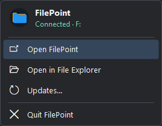

FilePoint’s source, installer downloads, and updates now live together in this repository. Existing installations can keep using the same public update feed.

- The refreshed system tray menu shows the connection and drive letter, with shortcuts for Explorer and updates.
- FilePoint prefers **F:** and displays the server’s reported capacity in **This PC**.

| Your PC | Installer |
| --- | --- |
| Snapdragon X Elite or other Windows 11 ARM64 PC | [Download ARM64 Setup](https://github.com/JNathan34/FilePoint-Windows-Downloads/releases/download/v1.4.6/FilePoint-Setup-arm64.exe) |
| Intel or AMD x64 PC | [Download x64 Setup](https://github.com/JNathan34/FilePoint-Windows-Downloads/releases/download/v1.4.6/FilePoint-Setup-x64.exe) |

Already running FilePoint? Select **Updates** from the system tray. Setup downloads the signed Dokan driver when needed. The release also includes standalone MSIs and SHA-256 checksums.

